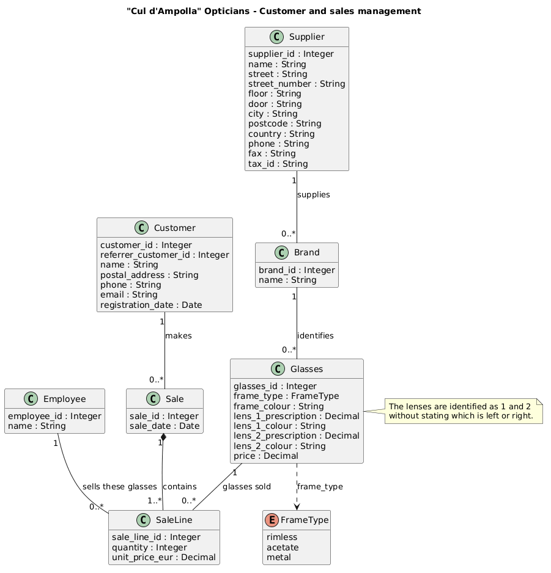

# Cul d'Ampolla Opticians

A MySQL database exercise for managing customers, suppliers, eyewear and sales at the fictional opticians **Cul d'Ampolla**.

## UML diagram



The editable PlantUML source is in [`exercise1.puml`](exercise1.puml).

## Data model

The schema contains the following tables:

- `Supplier`, `Brand` and `Glasses` record suppliers, their brands and the glasses they supply. Each brand has one supplier.
- `Customer` stores customer details and an optional self-referencing referrer.
- `Employee` stores employees.
- `Sale` records a customer's sale, while `SaleLine` records the glasses sold, quantity, employee responsible and unit price charged.

Each `Glasses` row stores the two lenses' prescriptions and colours separately. The lenses are labelled 1 and 2; the model does not assume which is left or right. Frame types are restricted to `rimless`, `acetate` and `metal`.

## Files

- [`schema.sql`](schema.sql) — drops and recreates the tables.
- [`data.sql`](data.sql) — inserts sample data and includes example queries.
- [`exercise1.puml`](exercise1.puml) — editable UML diagram source.
- [`opticians.png`](opticians.png) — UML diagram image used above.

## Requirements

MySQL with InnoDB and `utf8mb4` support. The scripts use MySQL's `ENUM` type.

## Set-up

Create an empty database, then run the scripts in this order:

```sh
mysql -u your_user -p -e "CREATE DATABASE cul_d_ampolla CHARACTER SET utf8mb4;"
mysql -u your_user -p cul_d_ampolla < schema.sql
mysql -u your_user -p cul_d_ampolla < data.sql
```

**Warning:** `schema.sql` drops the existing tables before recreating them. Running it again deletes the exercise data. Run `data.sql` after the schema has been created; it is a sample-data script, not an idempotent reload script.

## Example queries

The data script includes queries to:

- Count a customer's invoices within a date range.
- List the brands of glasses sold by employees during a year.
- List the suppliers whose glasses have been sold.
