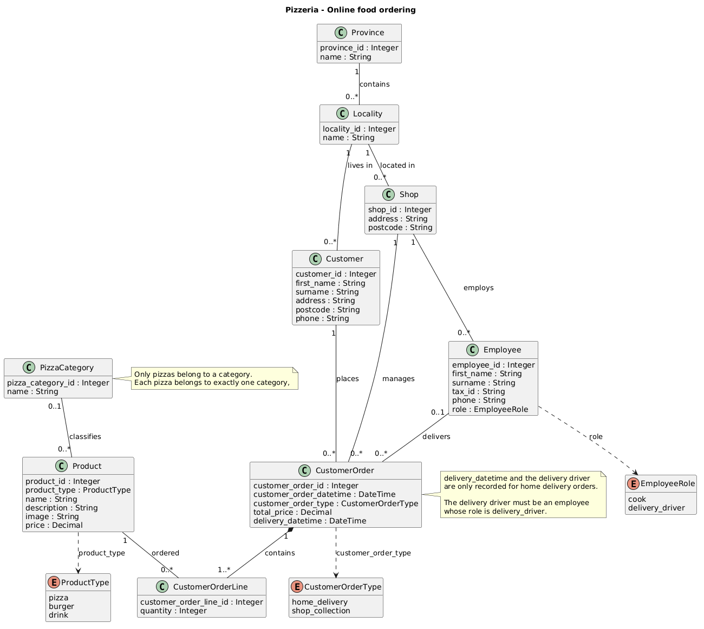

# Pizzeria

A MySQL database exercise for managing an online food-ordering service for a pizzeria chain, covering customers, shops, employees, products and orders.

## UML diagram



The editable PlantUML source is in [`exercise2.puml`](exercise2.puml).

## Data model

The schema contains the following tables:

- `Province` and `Locality` record the provinces and the localities within each one. Each locality belongs to one province.
- `Customer` stores customer details, including their address and locality.
- `Shop` stores each shop's address and locality.
- `Employee` stores the employees working at each shop. Roles are restricted to `cook` and `delivery_driver`.
- `PizzaCategory` stores the pizza categories, such as Classic or Gourmet.
- `Product` stores the products on sale, with their description, image and price. Product types are restricted to `pizza`, `burger` and `drink`.
- `CustomerOrder` records an order placed by a customer at a shop, with its date and time, type and total price.
- `CustomerOrderLine` records the products included in an order and their quantities.

The schema enforces the following business rules:

- Pizzas must belong to a category, while burgers and drinks must have no category.
- Orders are either `home_delivery` or `shop_collection`. Only home-delivery orders may record a delivery driver and a delivery date and time.
- Order line quantities must be greater than zero.
- Deleting an order also deletes its lines.

## Files

- [`schema.sql`](schema.sql) — drops and recreates the tables.
- [`data.sql`](data.sql) — inserts sample data and includes example queries.
- [`exercise2.puml`](exercise2.puml) — editable UML diagram source.
- [`pizzeria.png`](pizzeria.png) — UML diagram image used above.

## Requirements

MySQL 8.0.16 or later, with InnoDB and `utf8mb4` support. The scripts use MySQL's `ENUM` type and rely on enforced `CHECK` constraints.

## Set-up

Create an empty database, then run the scripts in this order:

```sh
mysql -u your_user -p -e "CREATE DATABASE pizzeria CHARACTER SET utf8mb4;"
mysql -u your_user -p pizzeria < schema.sql
mysql -u your_user -p pizzeria < data.sql
```

**Warning:** `schema.sql` drops the existing tables before recreating them. Running it again deletes the exercise data. Run `data.sql` after the schema has been created; it is a sample-data script, not an idempotent reload script.

## Example queries

The data script includes queries to:

- List how many drinks have been sold to customers in a given locality.
- Count how many orders a given employee has delivered.
