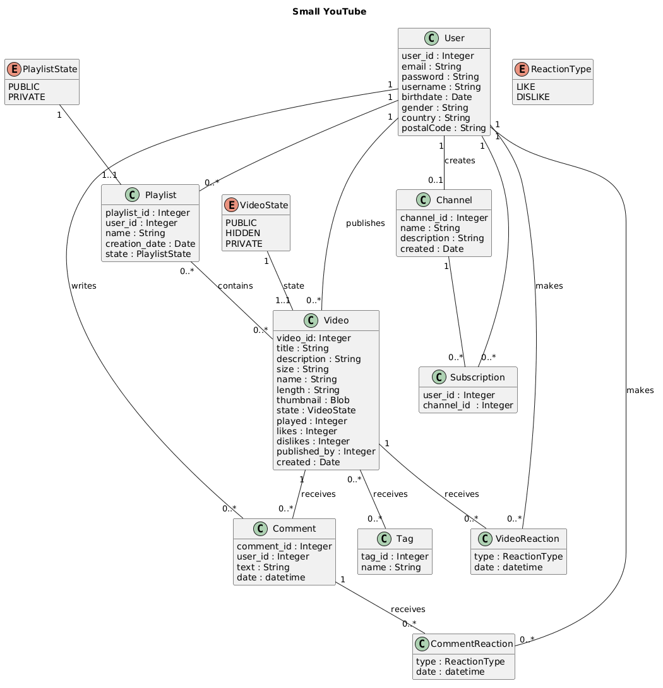

# Small YouTube

A MySQL database design exercise modelling a reduced version of YouTube, covering users, videos, channels, subscriptions, playlists, comments and reactions.

## UML diagram

The editable PlantUML source is in [`exercici1.puml`](exercici1.puml).

## Data model

The diagram contains the following entities:

- `User` stores each user's email, password, username, date of birth, gender, country and postcode.
- `Video` stores each video's title, description, size, file name, length, thumbnail, play count and numbers of likes and dislikes, together with the user who published it and the publication date. Video states are restricted to `PUBLIC`, `HIDDEN` and `PRIVATE`.
- `Tag` stores the tags attached to videos, each with a unique identifier and a name. A video can have many tags, and a tag can be applied to many videos.
- `Channel` stores a channel's name, description and creation date. Each user can create at most one channel.
- `Subscription` links a user to a channel they subscribe to.
- `Playlist` stores a user's playlists, with their name, creation date and state, and contains the videos added to it. A video can appear in many playlists. Playlist states are restricted to `PUBLIC` and `PRIVATE`.
- `Comment` records the comments a user writes on a video, with the comment text and the date and time it was written.
- `VideoReaction` and `CommentReaction` record the reactions a user makes to a video or a comment, with the date and time of each reaction. Reaction types are restricted to `LIKE` and `DISLIKE`.

The exercise statement sets the following business rules:

- A user can subscribe to other users' channels.
- A user can like or dislike a given video only once.
- The database must record which users liked or disliked a video or a comment, and the date and time they did so.

## Files

- [`exercici1.puml`](exercici1.puml) — editable UML diagram source.
- [`small_youtube.png`](small_youtube.png) — UML diagram image used above.
